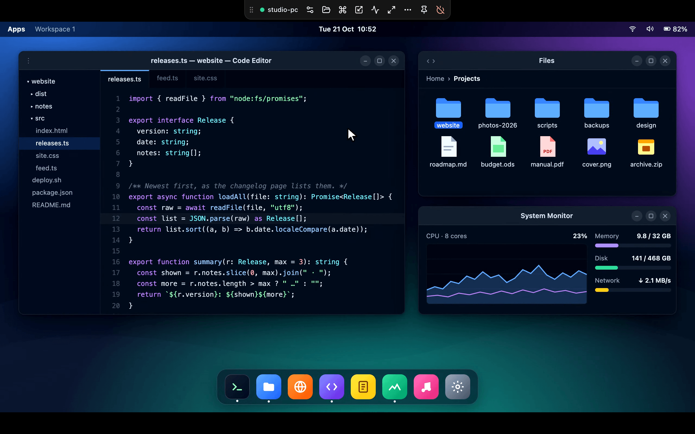
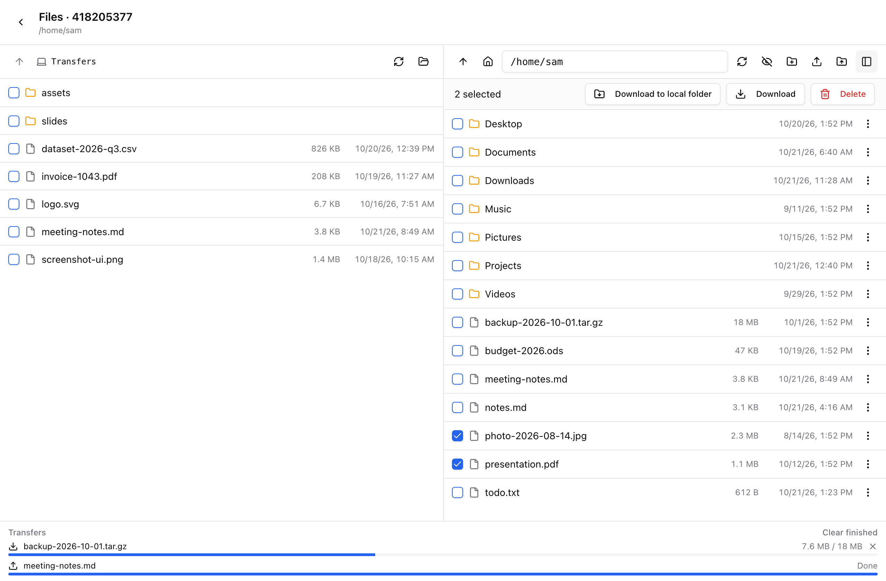
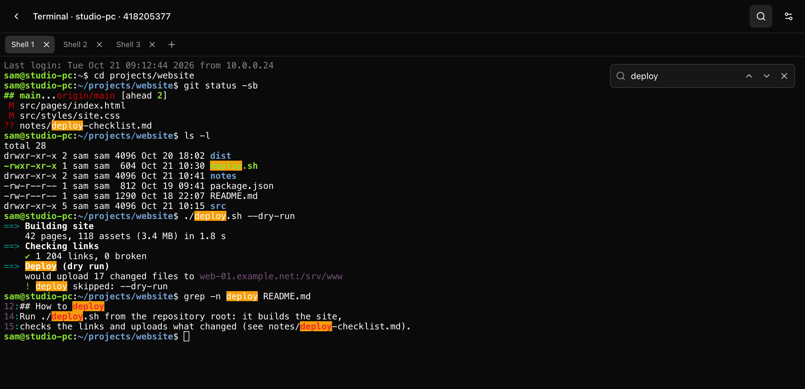
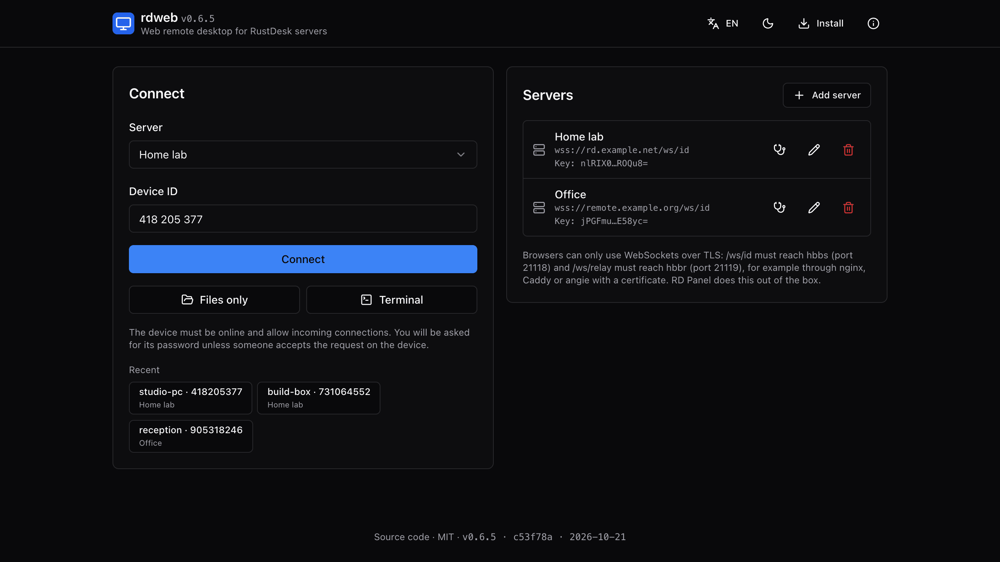

<p align="center">
  
</p>

<h1 align="center">rdweb</h1>

<p align="center">
  <b>A browser client for RustDesk servers.</b><br>
  Remote desktop, files and terminal in any modern browser. No plugins, no installs, no extra server.
</p>

<p align="center">
  <a href="https://github.com/bropines/rdweb/actions/workflows/ci.yml"></a>
  <a href="https://github.com/bropines/rdweb/releases/latest"></a>
  <a href="LICENSE"></a>
  <a href="https://bropines.github.io/rdweb/"></a>
</p>

<p align="center">
  
</p>

<table>
  <tr>
    <td width="33%" valign="top"></td>
    <td width="33%" valign="top"></td>
    <td width="33%" valign="top"></td>
  </tr>
  <tr>
    <td align="center"><sub>Two-pane file manager</sub></td>
    <td align="center"><sub>Remote shells in tabs</sub></td>
    <td align="center"><sub>The standalone app</sub></td>
  </tr>
</table>

rdweb connects to devices through the usual RustDesk server programs (hbbs
and hbbr) over WebSocket, verifies the device end to end and decodes video
with WebCodecs. It is three things:

- **`rdweb`**, a TypeScript library: headless sessions (protocol, crypto,
  media) and a DOM viewer, no UI framework.
- **`rdweb/react`**, the complete remote desktop screen as React components.
  [RD Panel](https://github.com/bropines/rdpanel) embeds it as its web client.
- **A standalone app** at <https://bropines.github.io/rdweb/>, a static page
  that works with any RustDesk server set up for browsers.

## Features

**Remote desktop**

- VP8, VP9, AV1, H.264 and H.265 through WebCodecs (hardware decoding where
  available), 4:4:4 true color for VP9 and AV1, live codec switching,
  latency-bounded decoding.
- Quality presets or custom quality and frame rate, remote resolution,
  several monitors, fit / 1:1 / stretch.
- Mouse, wheel and smooth touchpad scrolling. Touch screens work as a
  touchpad or as direct touch, with pinch zoom and Termux-style extra keys
  for on-screen keyboards (two rows, more layers behind the pinned ▲ key).
- Keyboard in Map (physical keys), Translate (local layout) or Legacy mode,
  IME input, Ctrl+Alt+Del, lock screen, fullscreen with keyboard lock.
- Clipboard text both ways, Opus audio, chat, screenshots. Pasting or
  dropping files onto the screen uploads them.
- View only, privacy mode, block user input, lock after the session,
  follow the remote cursor or window, remote cursor shapes.
- A floating toolbar with pinnable actions, connection details and a quality
  monitor.

**Terminal** (devices on RustDesk 1.4.1+)

- Several shells in tabs over one connection: PowerShell or cmd on Windows,
  the user's shell elsewhere.
- Shells survive disconnects: the terminal reconnects by itself, also after a
  page reload, and offers to return to shells that are still running.
- Search, clickable links, copy on select, right-click paste, Shift+Enter
  for CLIs, font settings and built-in Nerd Font icons for prompts.
- Inline images: SIXEL and iTerm's protocol, so `timg`, `chafa` and friends
  draw for real.

**Files**

- Browse folders (drives on Windows), download files and whole folders as
  streams, upload files and folders with replace / skip / resume, create,
  rename, delete.
- A local folder pane next to the remote one in Chromium browsers: copy both
  ways with buttons or by dragging rows.
- Bounded memory, WebSocket backpressure, progress and cancellation.

**Security**

- The server key vouches for the device's key and the device signs its
  session key; the session is end-to-end encrypted. Anything that does not
  verify is refused, with no fallback.
- Passwords never leave the encrypted session. "Remember password" keeps a
  salted hash, like the desktop client. 2FA and "accept on the remote side"
  logins.
- A server check that tests what a browser needs without contacting a device.

**Standalone app**

- Saved servers, RustDesk config string import, server check, recent devices,
  default connection settings and settings kept per device.
- RustDesk's public server as an experimental option when you have no server
  of your own.
- Installable app that starts offline, with an update prompt.
- English and Russian, light and dark theme, phone layouts. No backend, no
  analytics.

## Documentation

| guide | covers |
|---|---|
| [Standalone app](docs/standalone-app.md) | servers, config strings, the server check, installing, privacy |
| [Server setup](docs/server-setup.md) | reverse proxy for the hbbs/hbbr WebSockets, the key, the relay, `MUST_LOGIN`, RD Panel |
| [Library reference](docs/library.md) | `Session`, `Viewer`, `FileTransferSession`, `TerminalSession`, `checkServer`, errors |
| [React UI](docs/react.md) | `RemoteDesktop` and its modes, saved logins, storage, translations, styling |
| [Security model](docs/security.md) | the authentication chain, encryption, what TLS covers, remembered passwords |

## Try it

1. Open **<https://bropines.github.io/rdweb/>**.
2. Add your server: its host name and public key (`id_ed25519.pub`), or paste
   a RustDesk config string. The server must expose its WebSockets over TLS
   (see [Server requirements](#server-requirements); RD Panel does this out of
   the box). Without a server of your own, the app offers RustDesk's public
   server as an experimental option.
3. Enter a device id and connect, or open only its files or terminal.

To install it as an app, use the **Install** button in the header: it shows
the browser's own install prompt where there is one and the steps for every
browser. The installed app starts even when GitHub Pages is unreachable.

## Use the library

rdweb is not on the npm registry; install a release tarball (see the
[latest release](https://github.com/bropines/rdweb/releases/latest)):

```sh
npm install https://github.com/bropines/rdweb/releases/download/v0.6.5/rdweb-0.6.5.tgz
```

A remote desktop in a `<div>`:

```ts
import { Session, Viewer } from "rdweb";

const server = { rendezvousUrl: "wss://rd.example.com/ws/id", key: "<contents of id_ed25519.pub>" };
const session = new Session({ peerId: "123456789", server });
new Viewer(document.getElementById("screen")!, session);

session.on("password", ({ wrong }) => askPassword(wrong).then((p) => session.login(p)));
session.on("close", ({ reason }) => console.log(reason));
await session.connect();
```

Files and a terminal:

```ts
import { FileTransferSession, TerminalSession } from "rdweb";

const ft = new FileTransferSession({ peerId: "123456789", server });
await ft.connect();
const home = await ft.listDir(ft.homeDir);
const { blob } = await ft.downloadBlob(ft.joinPath(ft.homeDir, "notes.txt"));

const term = new TerminalSession({ peerId: "123456789", server, cols: 120, rows: 32 });
term.on("data", ({ data }) => xterm.write(data));
await term.connect();
term.write("uname -a\r");
```

Check a server without contacting a device:

```ts
import { checkServer } from "rdweb";

const { ok, steps } = await checkServer(server, { peerId: "123456789" });
// steps: rendezvous, key, relay, device; each ok / fail / skip with a time
```

The whole screen in React, in one of three modes:

```tsx
import { RemoteDesktop, Toaster } from "rdweb/react";
import "rdweb/react/style.css"; // or build the components with your own Tailwind

<Toaster />
<RemoteDesktop peerId="123456789" server={server} mode="desktop" onLeave={() => navigate("/")} />
// mode="files": only the file manager; mode="terminal": only remote shells
```

The React UI needs React 18 or 19, Radix UI primitives, lucide-react and
sonner as peer dependencies; see [docs/react.md](docs/react.md#installation).

## Server requirements

Browsers only speak WebSocket, over TLS from an HTTPS page. The server must
expose hbbs and hbbr behind a reverse proxy with a certificate:

| URL | upstream |
|---|---|
| `wss://<host>/ws/id` | hbbs, port 21118 (WebSocket) |
| `wss://<host>/ws/relay` | hbbr, port 21119 (WebSocket) |

```nginx
# nginx or Angie, inside the server block for <host>
location /ws/id    { proxy_pass http://127.0.0.1:21118; include ws.conf; }
location /ws/relay { proxy_pass http://127.0.0.1:21119; include ws.conf; }

# ws.conf
proxy_http_version 1.1;
proxy_set_header Upgrade $http_upgrade;
proxy_set_header Connection "upgrade";
proxy_set_header X-Real-IP $remote_addr;
proxy_set_header X-Forwarded-For $remote_addr;
proxy_read_timeout 1h;
```

You also need the server's public key (`id_ed25519.pub`). Caddy, the relay,
servers with `MUST_LOGIN` and troubleshooting:
[docs/server-setup.md](docs/server-setup.md).

## Browser support

| | Chrome, Edge and other Chromium browsers | Safari 17+ | Firefox 130+ |
|---|---|---|---|
| Remote desktop | yes | yes | yes, VP8 / VP9 / AV1 |
| Files and terminal | yes | yes | yes |
| Local folder pane, folder downloads into a picked folder | yes | zip download | zip download |
| Install as an app | yes | yes (Add to Dock, Add to Home Screen) | Android only |

Video needs WebCodecs; only codecs the browser can decode are offered to the
device, and H.265 depends on the platform's decoders. Audio uses WebCodecs or,
where that is missing, a WebAssembly Opus decoder.

## Development

```sh
npm ci
npm test            # unit tests, plus sessions against an in-memory server and device
npm run typecheck
npm run build       # dist/: the core, rdweb/react and its stylesheet
npm run dev         # demo page at http://127.0.0.1:5199 (remote desktop or files)
npm run dev:app     # the standalone app at http://127.0.0.1:5200/rdweb/
npm run build:app   # app/dist, as deployed to GitHub Pages
npm run gen         # regenerate src/proto from proto/*.proto (buf)
```

| path | contents |
|---|---|
| `src/` | the core: sessions, crypto, transport, video, audio, viewer |
| `src/react/` | `rdweb/react` |
| `app/` | the standalone app |
| `proto/` | the protocol messages rdweb uses |
| `test/` | Vitest tests; `test/peer.ts` and `test/fakefs.ts` are an in-memory hbbs, hbbr and device |
| `demo/` | a plain demo page for the library |

`test/e2e-node.mjs` runs a real session from Node against a live server and
device. Releases attach the npm package to a GitHub release (tag `vX.Y.Z`),
and the [pages workflow](.github/workflows/pages.yml) deploys the app on every
push to `main`.

## License and notices

MIT, see [LICENSE](LICENSE). [NOTICE](NOTICE) lists the third-party parts
(shadcn/ui components, Tailwind CSS, Nerd Fonts symbols, xterm.js styles).

RustDesk is a trademark of its respective owners (Purslane Ltd.). rdweb is an
independent client that speaks the RustDesk network protocol; it is not
affiliated with or endorsed by RustDesk or Purslane Ltd. The protocol
definitions in `proto/` were written for this project; no RustDesk source
code is included.
