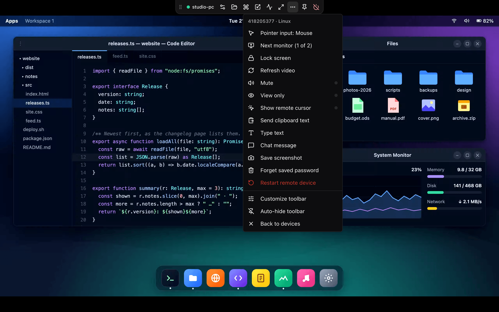
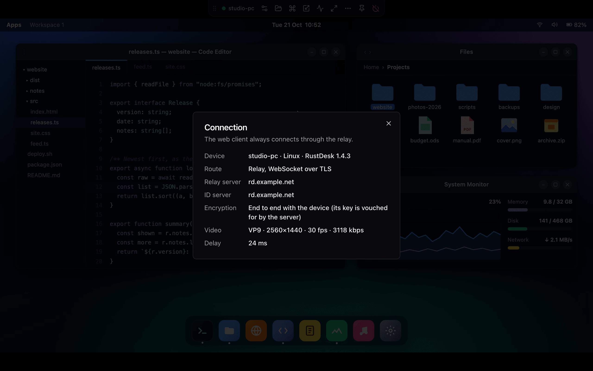
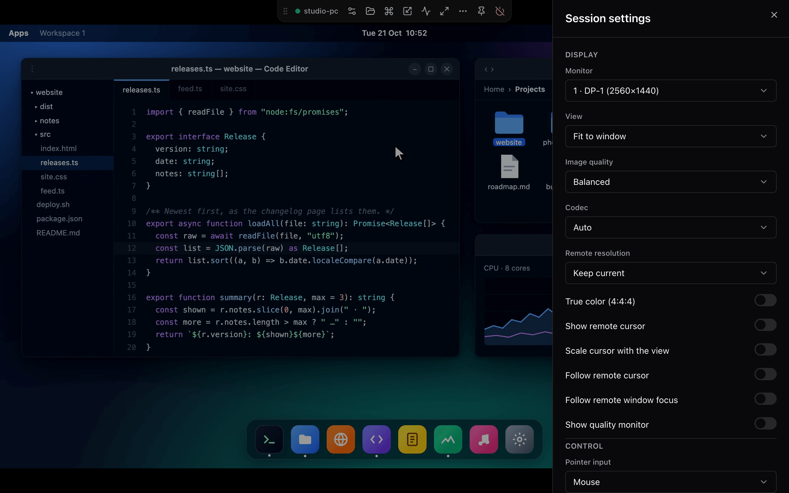
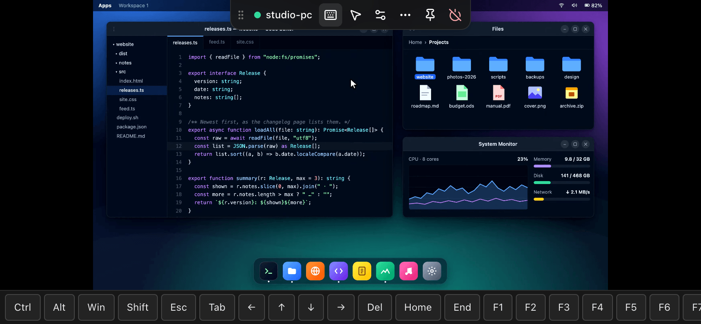
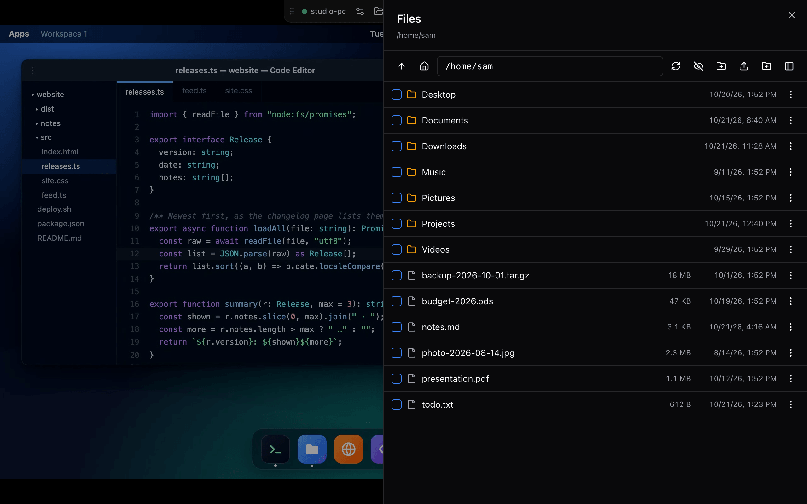
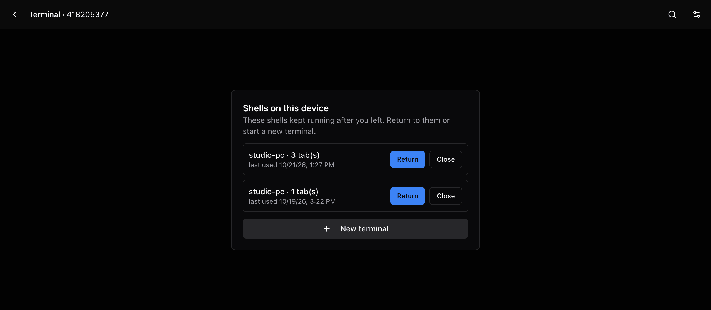

# React UI (`rdweb/react`)

`rdweb/react` is the complete remote desktop screen as React components:
video and input, a floating toolbar, settings, a file manager, a terminal and
the login dialogs. [RD Panel](https://github.com/bropines/rdpanel) embeds it as
its web client and the [standalone app](standalone-app.md) is built from it.

<p align="center">
  
</p>

Contents:

- [Installation](#installation)
- [Quick start](#quick-start)
- [`RemoteDesktop` props](#remotedesktop-props)
- [Saved logins](#saved-logins)
- [Desktop mode](#desktop-mode)
- [Files mode](#files-mode)
- [Terminal mode](#terminal-mode)
- [What is stored in the browser](#what-is-stored-in-the-browser)
- [Translations](#translations)
- [Other exports](#other-exports)
- [Styling](#styling)
- [Content Security Policy](#content-security-policy)

## Installation

Install the package from a [release](https://github.com/bropines/rdweb/releases)
(it is not on the npm registry) and the peer dependencies the UI uses, so the
host has one copy of each:

```sh
npm install https://github.com/bropines/rdweb/releases/download/v0.6.5/rdweb-0.6.5.tgz
npm install react react-dom lucide-react sonner \
  @radix-ui/react-checkbox @radix-ui/react-dialog @radix-ui/react-dropdown-menu \
  @radix-ui/react-label @radix-ui/react-select @radix-ui/react-separator \
  @radix-ui/react-slot @radix-ui/react-switch
```

React 18 and 19 are supported. The peer dependencies are optional for hosts
that use only the core `rdweb` entry. xterm.js (for the terminal) is a regular
dependency and is loaded on demand.

## Quick start

```tsx
import { RemoteDesktop, Toaster } from "rdweb/react";
import "rdweb/react/style.css"; // only without your own Tailwind build, see Styling

export function Remote({ id, onBack }: { id: string; onBack: () => void }) {
  return (
    <>
      <Toaster />
      <RemoteDesktop
        peerId={id}
        server={{ rendezvousUrl: "wss://rd.example.com/ws/id", key: SERVER_KEY }}
        lang="en"
        onLeave={onBack}
      />
    </>
  );
}
```

`RemoteDesktop` renders a fixed, full-viewport screen. Keep it mounted for the
whole session: unmounting disconnects, and changing `peerId` or the server
starts a new session. Events such as chat messages, clipboard notices and
errors are shown with sonner's `toast()`: any sonner `<Toaster />` in the host
shows them, or render rdweb's `Toaster` if the host has none.

## `RemoteDesktop` props

| prop | type | modes | description |
|---|---|---|---|
| `peerId` | `string` | all | device id |
| `server` | `ServerConfig` | all | hbbs/hbbr WebSocket endpoints and the server key, see [library.md](library.md#serverconfig) |
| `onLeave` | `() => void` | all | required: "Back" in the toolbar and after the session ended |
| `mode` | `"desktop" \| "files" \| "terminal"` | | default `"desktop"`. `"files"`: only the file manager (a file transfer connection, no screen). `"terminal"`: only remote shells |
| `lang` | `"en" \| "ru"` | all | UI language, default `"en"` |
| `messages` | `DeepPartial<Messages>` | all | override single strings, e.g. `{ toolbar: { back: "Back to the panel" } }` |
| `credentials` | `RemoteDesktopCredentials \| null` | all | saved logins the host found, see [Saved logins](#saved-logins) |
| `myName` | `string` | all | shown to the remote user in the connection request |
| `myId` | `string` | all | our id as announced to the device |
| `storageKey` | `string` | all | prefix of what is kept in this browser, default `"rdweb"`; see [What is stored](#what-is-stored-in-the-browser) |
| `onReconnect` | `() => void` | desktop, terminal | "Reconnect" after the session ended. Default: remount internally. Pass it to refetch credentials first |
| `onConnected` | `(peer: PeerSummary) => void` | desktop | the session is up |
| `onRemembered` | `(hash: Uint8Array) => void \| Promise` | desktop | login with "remember" ticked; the hash is also kept in this browser. A rejected promise shows an error toast |
| `onForget` | `() => void \| Promise` | desktop | the saved password should be forgotten (see `credentials.fromPersonalBook`) |
| `rememberLabel`, `rememberHint` | `string` | desktop | text of the "remember" checkbox and the hint under it, e.g. "Remember in my account" |
| `extraActions` | `ToolbarAction[]` | desktop | more toolbar actions, pinnable like the built-in ones |
| `shellStore` | `ShellStore` | terminal | where kept shells are remembered for a later reattach; default: this browser's localStorage |
| `className` | `string` | all | classes for the full-screen shell |

## Saved logins

`credentials` passes logins the host knows, for example from a user's address
book:

```ts
interface RemoteDesktopCredentials {
  /** Salted password hash, SHA256(password || salt), as stored by "remember password". */
  rememberedHash?: Uint8Array;
  /** Plain password, tried once when the device asks for one. */
  password?: string;
  /** The hash belongs to the user (their personal address book). */
  fromPersonalBook?: boolean;
}
```

The desktop and terminal modes try them in the desktop client's order: the
hash remembered in this browser, then `credentials.rememberedHash`, then
`credentials.password`, then the password dialog. Files mode tries the hashes
and otherwise asks in the file manager.

When the user ticks "remember" in the password dialog, the salted hash (not
the password) is stored in this browser and passed to `onRemembered`, so a
host with accounts can keep it server side. With `fromPersonalBook`, a hash
the device rejects calls `onForget`, and the toolbar offers "Forget saved
password" for it.

## Desktop mode

The screen: video and input (see [Viewer](library.md#viewer)), the floating
toolbar, the settings and files sheets, password, 2FA, clipboard, type text,
chat and restart dialogs, an extra keys row for on-screen keyboards, the
quality monitor, and handling of the visual viewport so the screen stays above
on-screen keyboards. Browsers without WebCodecs get an explanation instead of
a black screen.

### Toolbar

The toolbar floats at the top of the screen and folds into a small handle a
few seconds after the pointer leaves it. The pin keeps it open; on wider screens
the grip moves it along the top edge. The dot and the device name open the
connection details. Pinned actions sit on the bar, everything else is in the
**⋯** menu, and **⋯ → Customize toolbar** picks what is pinned. Choices are
remembered in the browser.

<table>
  <tr>
    <td width="50%"></td>
    <td width="50%"></td>
  </tr>
  <tr>
    <td align="center"><sub>The ⋯ menu with every action</sub></td>
    <td align="center"><sub>Connection details from the status dot</sub></td>
  </tr>
</table>

Built-in actions (`ActionId`): `settings`, `files`, `keyboard` (touch screens),
`inputMode`, `viewMode`, `nextDisplay` (several monitors), `ctrlAltDel`,
`lockScreen`, `refresh`, `mute`, `viewOnly`, `remoteCursor`, `stats`,
`clipboard` (send clipboard text), `typeText`, `chat`, `screenshot`, `privacy`
and `blockInput` (where the device supports them), `fullscreen`,
`forgetPassword` (when a password is saved), `restart` and `sound` (shown
while the browser blocks audio until a click).

Pinned by default: `DEFAULT_PINNED_DESKTOP` (`settings`, `ctrlAltDel`,
`viewMode`, `fullscreen`) with a mouse, `DEFAULT_PINNED_TOUCH` (`keyboard`,
`inputMode`, `settings`) on touch screens.

Host actions are added with `extraActions`:

```tsx
import { Bookmark } from "lucide-react";

<RemoteDesktop
  {...props}
  extraActions={[{ id: "bookmark", label: "Add to favourites", icon: Bookmark, run: () => addFavourite(peerId) }]}
/>
```

`ToolbarAction` is `{ id, label, icon, run, active?, disabled?, hidden?,
danger?, forcePinned? }`; `icon` is a lucide-react icon component.

### Settings

<p align="center">
  
</p>

Display: monitor, view (fit, original size, stretch), image quality presets
or custom quality and frame rate, codec, remote resolution, true color
(4:4:4), show remote cursor, scale the cursor with the view, follow the
remote cursor or window focus, quality monitor. Control: pointer input
(mouse, touchpad, touch), keyboard mode (map, translate, legacy), swap
Ctrl and Cmd/Win, view only, mute, clipboard, lock after the session ends,
privacy mode and block user input.

What a session changes is remembered for that device (like the desktop
client's per-device settings); devices without settings of their own use the
defaults, and the sheet's **Reset to the defaults** goes back to them. Only
the differences are stored, so later changes to the defaults still reach every
device that did not override them. Pointer input, the cursor scaling, the
quality monitor and the toolbar are the same for every device; view only is
per session and never restored. `ConnectionSettingsDialog` edits the defaults
before connecting (the standalone app's **Connection settings**):

```tsx
import { ConnectionSettingsDialog } from "rdweb/react";

<ConnectionSettingsDialog open={open} onOpenChange={setOpen} storageKey="rdweb" lang="ru" />;
```

### Touch screens

<p align="center">
  
</p>

On touch screens the toolbar has a larger handle and the keyboard button,
which opens the on-screen keyboard together with two rows of extra keys, laid
out like Termux: Esc, Tab, Del, Home, End, PgUp, PgDn, arrows that repeat while
held, and Ctrl, Alt, Win (Cmd on a Mac, Super on Linux) and Shift as sticky
modifiers that also apply to the next letter typed on the phone keyboard
(Ctrl, then C sends Ctrl+C). The pinned ▲ key shows more layers above: F1–F12,
Ins, PrtSc, Menu, Backspace, Enter. The session stays above the on-screen
keyboard. The touch screen works as a touchpad or as direct touch, with pinch
zoom.

### Files from the screen

Pasting files (Ctrl/Cmd+V) or dropping them onto the remote screen opens the
file manager and uploads them into the open remote folder. Pasted text goes to
the remote clipboard and the remote paste shortcut is pressed, so Cmd+V on a
Mac pastes on a Windows PC too.

## Files mode

`mode="files"` shows only the file manager, on a file transfer connection
like the desktop client's "Transfer files". In desktop mode the same file
manager opens as a side sheet and signs in with the session's login.

<p align="center">
  
</p>

- Browse folders (drives on Windows), show hidden files, type a path.
- Download files and folders. Chromium browsers save folders straight into a
  folder the user picks; Safari and Firefox get a zip archive (up to 4 GiB).
- Upload files and folders with the buttons or by drag and drop; existing
  files can be replaced, skipped or resumed.
- Create, rename and delete.
- **Local folder** (Chromium browsers, File System Access API): a second pane
  with a folder on this computer. Files and folders are copied both ways with
  the buttons or by dragging rows between the panes; replacing local files is
  confirmed first. Whether the pane is open and which folder it shows are
  remembered, so after a reload at most a "Reconnect folder" click brings it
  back. Safari and Firefox keep the single remote list.

<p align="center">
  
</p>

## Terminal mode

`mode="terminal"` opens remote shells (devices on RustDesk 1.4.1 or later):
PowerShell or cmd on Windows, the user's shell elsewhere.

<p align="center">
  
</p>

- Tabs: up to 8 shells over one connection.
- Search with Ctrl+Shift+F (⌘F on macOS), with next and previous match.
- Links open on click (http and https only).
- Copy on select, right click copies the selection or pastes.
- Shift+Enter sends a newline for CLIs that expect one (ESC CR, like
  Alt+Enter); Ctrl/Cmd + `=` `-` `0` change the font size; Shift+PageUp,
  PageDown, Home and End page through the scrollback.
- Option works as Alt on macOS (can be turned off).
- Touch screens get two rows of extra keys, laid out like Termux: Esc, `/`,
  `-`, Home, End, PgUp, PgDn, Tab, arrows that repeat while held, and sticky
  Ctrl, Alt and Shift (Shift+Tab, Ctrl+arrows, Ctrl then a letter from the
  phone keyboard; Shift then Enter is a new line). Swipe up on `/` or `-` for
  `\` or `|`. The pinned ▲ key shows more layers above: F1–F12, ^C ^D ^Z ^L
  ^R, Ins, Del, Paste and `` | ~ ` \ { } [ ] < > ``; a swipe down over ▲ hides
  the bar (the keyboard button in the header brings it back). The terminal stays above the
  on-screen keyboard, one finger scrolls with momentum (no pull-to-refresh), and
  a two-finger pinch changes the font size (5–32).
- Touch selection: a long press selects the word under the finger, dragging
  extends it (scrolling at the top and bottom edge), and a menu offers Copy,
  Paste and Select all. A long press never pastes.
- "Send letters as you type" (touch screens, on by default): phone keyboards
  such as Gboard or Yandex hold a word until space; with this every letter goes
  out at once, so shells highlight and complete as you type. The arrows of the
  keyboard's own editing panel (Yandex, Gboard) move the shell's cursor, and
  Yandex Keyboard's start and end keys work as Home and End.
- Rendering uses WebGL where available (the DOM otherwise): box drawing, block
  elements and powerline glyphs are drawn by the terminal itself, so frames and
  TUIs have no gaps even with a phone's system font.
- Windows devices: xterm runs in ConPTY mode and tells the device about a new
  size once it settles, so resizing garbles the history less.
- Settings (kept in this browser): a font installed on the computer (empty:
  system monospace), font size, and a built-in Symbols Nerd Font for prompt
  icons (oh-my-posh, starship), loaded on demand (about 1.6 MB, once).

### Keeping shells

"Keep shells after a disconnect" is on by default. The device then keeps the
shells running when the connection drops: the terminal reconnects by itself
and gets them back with their recent output, also after a page reload. "Back"
ends them.

Shells that are still running on the device when the terminal opens again
(in another tab, or in another browser with a server-side `ShellStore`) are
offered before connecting:

<p align="center">
  
</p>

Where they are remembered is a `ShellStore`. The default,
`localShellStore(storageKey, serverKey, peerId)`, keeps up to 10 per device in
this browser's localStorage. A host with accounts can keep them server side so
the user finds them in any browser:

```ts
interface SavedShells {
  serviceId: string; // the device's id for the set of shells
  hostname?: string;
  tabs: number;
  createdAt: number; // ms since the epoch
  updatedAt: number;
}

interface ShellStore {
  list(): Promise<SavedShells[]>;
  save(shells: SavedShells): Promise<void>;
  remove(serviceId: string): Promise<void>;
}

const shellStore: ShellStore = {
  list: () => api.shells(peerId),
  save: (s) => api.saveShell(peerId, s),
  remove: (id) => api.forgetShell(peerId, id),
};
<RemoteDesktop mode="terminal" shellStore={shellStore} {...props} />;
```

A service id lets whoever has it reattach, but the device still asks for its
own login on every connection.

`remove` is called only when the shells are known to be over: every one of
them exited, the user ended them from the chooser or with "Back", or a
reattach came back with a service id the device chose itself (the one asked
for was gone). A dropped connection never removes anything — the shells are
very probably still running, and with a server-side store `remove` deletes
them from the account, for every browser the user has.

"Keep an idle session open" is on by default and probes the connection every
10 seconds while nothing is typed or printed. A shell sitting idle sends no
traffic, and a relay closes a connection that carries none (hbbr after 30 s),
which is what ends a terminal left open while nobody is at the keyboard.

## What is stored in the browser

Everything is under the `storageKey` prefix (default `rdweb`):

| key | storage | description |
|---|---|---|
| `<prefix>.prefs` | localStorage | the default connection settings, view and toolbar choices |
| `<prefix>.device.<first 16 characters of the server key>.<device id>` | localStorage | a device's own settings (the differences from the defaults) |
| `<prefix>.pw.<first 16 characters of the server key>.<device id>` | localStorage | a remembered password hash, base64 |
| `<prefix>.recent` | localStorage | the last 8 devices connected to |
| `<prefix>.files.localPane` | localStorage | the file manager's local pane is open |
| `<prefix>.files.localFolder` | IndexedDB `rdweb-files`, store `handles` | the local pane's folder handle |
| `<prefix>.terminal` | localStorage | terminal settings |
| `<prefix>.terminal.shells.<server key>.<device id>` | localStorage | remembered shells (`localShellStore`) |
| `<prefix>.terminal.service.<server key>.<device id>` | sessionStorage | the shells of this tab, for reconnects and reloads |

`clearStoredData(storageKey)` removes all of it: the settings (default and
per device), remembered password hashes, recent devices, the local pane's
state, the terminal settings and the remembered shells.

`storageKey: RDPANEL_STORAGE_KEY` (`"rdpanel.webclient"`) reads the data of RD
Panel's own earlier web client as it is (the layout is the same) and removes
the plaintext passwords its first version stored (`migrateStorage`).

## Translations

English and Russian are built in, with the same keys (a test checks it);
Russian plurals use `Intl.PluralRules`. There is no i18next dependency.

- `lang` picks the catalog; `messages` overrides single strings.
- `messages.en` and `messages.ru` are the catalogs, `Messages` their type.
- `createTranslator(lang, overrides?)` returns `t(key, vars?)`; missing keys
  fall back to English, then to `defaultValue`, then to the key.
- `resolveLang("ru-RU")` gives `"ru"`; anything unknown gives `"en"`.
- `I18nProvider` and `useI18n` provide strings to rdweb components used
  outside `RemoteDesktop` (which sets up its own provider).

## Other exports

| export | description |
|---|---|
| `Toolbar`, `ToolbarAction`, `ActionId`, `ToolbarProps`, `DEFAULT_PINNED_DESKTOP`, `DEFAULT_PINNED_TOUCH` | the floating toolbar on its own |
| `SettingsSheet`, `SettingsSheetProps` | the settings sheet, controlled by the host |
| `SettingsFields`, `SettingsFieldsProps` | the sheet's settings, for a host's own dialog (`peer: null`: every codec, no session-only choices) |
| `ConnectionSettingsDialog`, `ConnectionSettingsDialogProps` | the default connection settings dialog |
| `FilesSheet`, `FilesSheetProps` | a complete file manager on its own `FileTransferSession`; `inline` renders it as a page instead of a side sheet |
| `RemoteTerminal` | the terminal screen (`RemoteDesktopProps` plus a required `onReconnect`) |
| `localShellStore`, `ShellStore`, `SavedShells` | see [Keeping shells](#keeping-shells) |
| `Toaster` | a sonner toast host styled like shadcn/ui |
| `ZipWriter`, `ZipTooLargeError`, `crc32` | the streaming zip writer used for folder downloads without a folder picker (stored, no ZIP64: up to 4 GiB) |
| `formatSize(bytes, lang?)` | "512 B", "1.5 MB" |
| `loadRecent`, `pushRecent`, `loadPrefs`, `savePrefs`, `loadDevicePrefs`, `saveDevicePrefs`, `withDevicePrefs`, `devicePrefsOf`, `DEVICE_SETTING_KEYS`, `loadRememberedHash`, `saveRememberedHash`, `hasRememberedHash`, `migrateStorage`, `clearStoredData`, `DEFAULT_STORAGE_KEY`, `RDPANEL_STORAGE_KEY` | the storage helpers above |
| `messages`, `createTranslator`, `resolveLang`, `I18nProvider`, `useI18n` | see [Translations](#translations) |
| `cn` | merges Tailwind class names (the shadcn/ui helper) |

## Styling

The components use Tailwind CSS 3 utility classes and the
[shadcn/ui](https://ui.shadcn.com) theme variables (`--background`,
`--foreground`, `--primary`, `--muted-foreground`, `--border`, `--ring`,
`--destructive`, ... as HSL triplets, plus `--radius`). Pick one of two ways.

**1. Your own Tailwind build** (hosts that already use shadcn/ui): add the
compiled components to `content` and keep your theme.

```js
// tailwind.config.js
content: ["./src/**/*.{ts,tsx}", "./node_modules/rdweb/dist/react/**/*.js"],
```

The config needs the shadcn color names mapped to the variables and the
`tailwindcss-animate` plugin, which the shadcn defaults already have.
[`tailwind.preset.js`](../tailwind.preset.js) in this repository is that
setup (it is not part of the package).

**2. The prebuilt stylesheet** (no Tailwind in the host):

```ts
import "rdweb/react/style.css";
```

It holds the utilities rdweb uses, the theme variables and a base reset, all
scoped to the `.rdweb` class that every rdweb root carries: the session shell
and each dialog, sheet, menu, select and toast. The host page is not reset.
Dark colors apply under a `dark` class on any ancestor (usually `<html>`) or
on the element itself. To re-theme, override the variables on `.rdweb`:

```css
.rdweb { --primary: 262 83% 58%; --radius: 0.75rem; }
.dark .rdweb { --primary: 263 70% 66%; }
```

Utility class names are Tailwind's, unprefixed. `Viewer` (used inside) adds
a small stylesheet of its own for the screen elements.

## Content Security Policy

What a page that embeds rdweb needs, from the standalone app's policy:

```
default-src 'self';
script-src 'self' 'wasm-unsafe-eval';
style-src 'self' 'unsafe-inline';
img-src 'self' data: blob:;
media-src 'self' blob:;
connect-src 'self' wss://rd.example.com;
```

- `connect-src` must allow the hbbs and hbbr WebSocket URLs.
- `'wasm-unsafe-eval'` is for the WebAssembly Opus decoder, used for audio
  where the browser has no WebCodecs audio decoder.
- `'unsafe-inline'` styles: the viewer, the terminal and the Radix primitives
  set inline styles and inject small stylesheets.
- `data:` images are remote cursor shapes.
