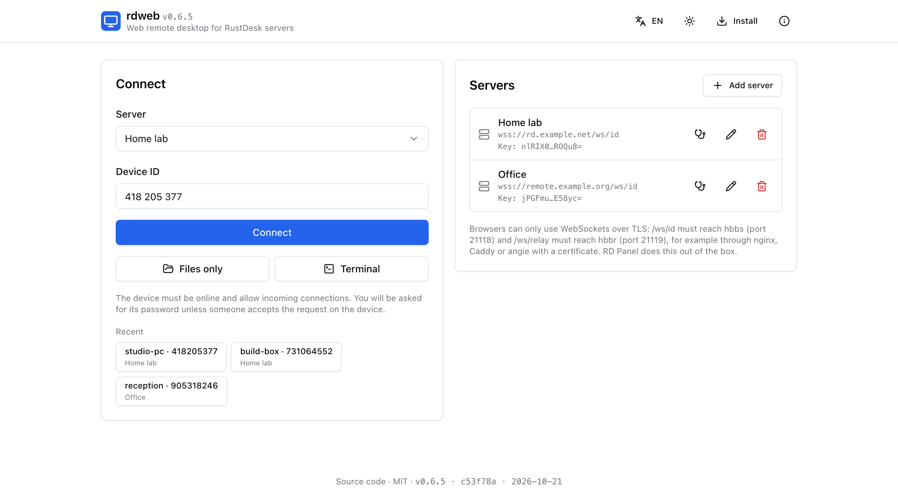
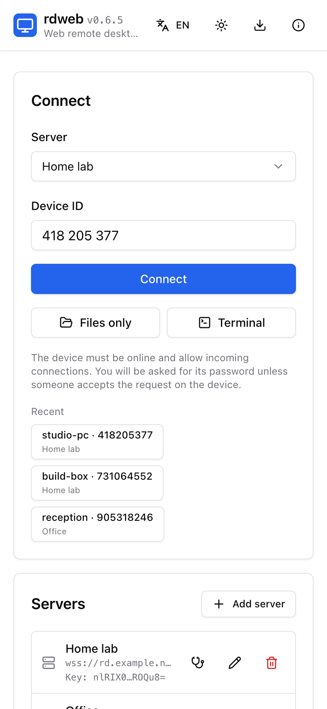
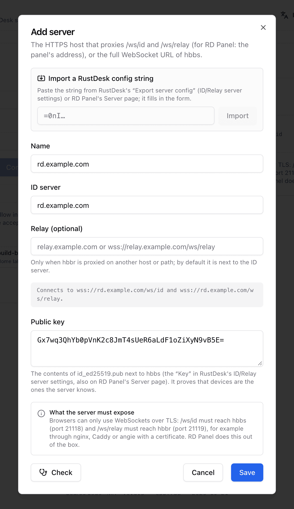
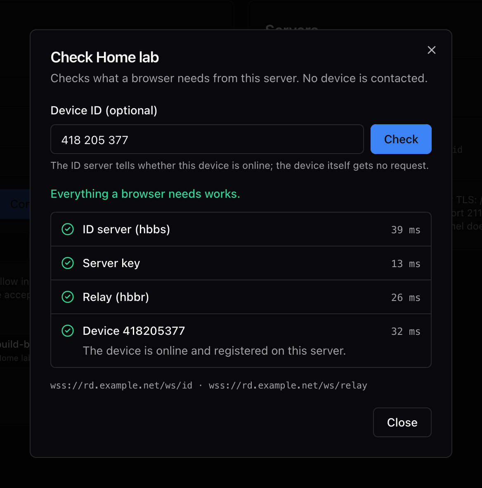
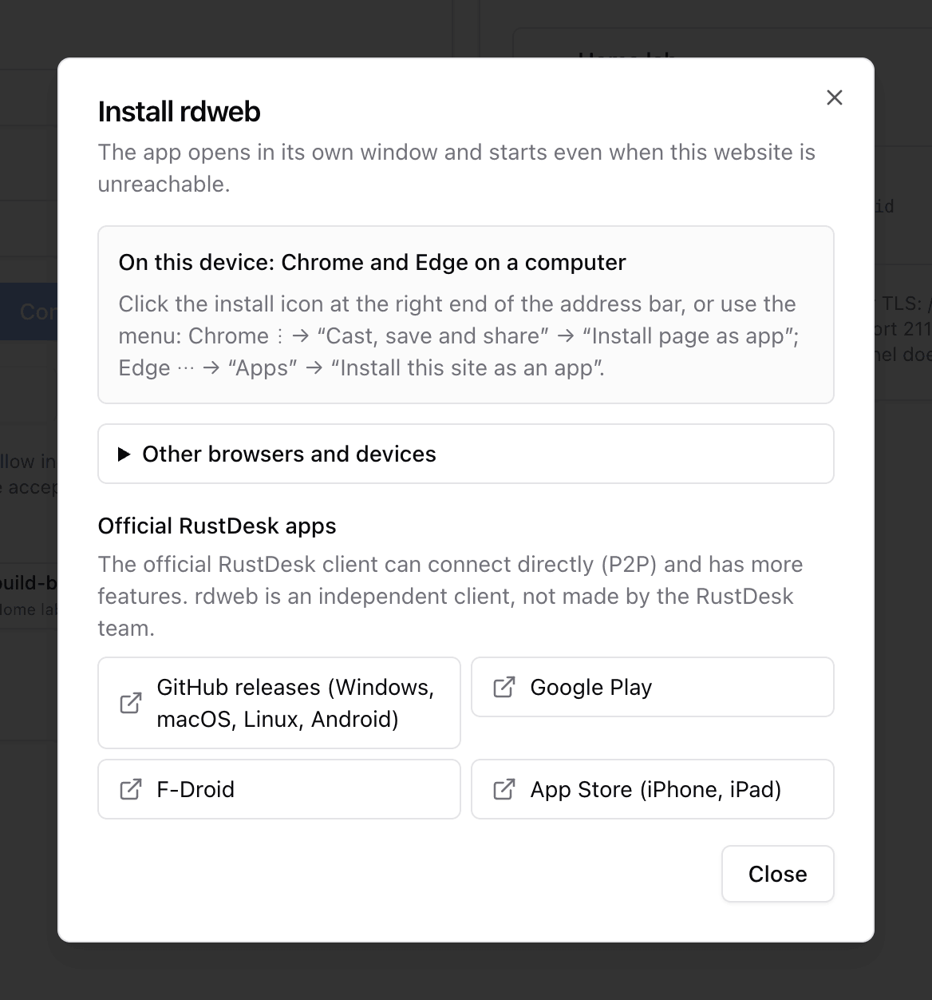

# Standalone web client

**<https://bropines.github.io/rdweb/>** is a static page built from this
repository (`app/`): add your server, enter a device id, connect. It runs
entirely in the browser, has no backend, and can be installed as an app.

<table>
  <tr>
    <td width="40%"></td>
    <td width="40%"></td>
    <td width="20%"></td>
  </tr>
</table>

Contents:

- [What the server needs](#what-the-server-needs)
- [Adding a server](#adding-a-server)
- [RustDesk's public server](#rustdesks-public-server)
- [Connecting](#connecting)
- [Checking a server](#checking-a-server)
- [Installing the app](#installing-the-app)
- [Privacy](#privacy)
- [Hosting it yourself](#hosting-it-yourself)

## What the server needs

Browsers can only open WebSockets, and from an HTTPS page only over TLS. The
server must expose hbbs and hbbr through a reverse proxy with a certificate:

| URL | upstream |
|---|---|
| `wss://<host>/ws/id` | hbbs, port 21118 (WebSocket) |
| `wss://<host>/ws/relay` | hbbr, port 21119 (WebSocket) |

[RD Panel](https://github.com/bropines/rdpanel) does this out of the box. For
nginx, Angie and Caddy examples see [server-setup.md](server-setup.md).

The app cannot send a server login token, so servers that run hbbs with
`MUST_LOGIN=Y` refuse its connections; use RD Panel's built-in web client for
those.

## Adding a server

"Add server" asks for:

| field | description |
|---|---|
| Name | anything; defaults to the host |
| ID server | a host name (`rd.example.com`, which becomes `wss://rd.example.com/ws/id`) or the full hbbs WebSocket URL. RustDesk ports (21114 to 21119) are dropped from host names, since they never serve TLS |
| Relay (optional) | only when hbbr is proxied on another host or path; by default it is next to the ID server (`/ws/relay` on the same host) |
| Public key | the contents of `id_ed25519.pub` next to hbbs (the "Key" in the RustDesk client's ID/Relay server settings, also on RD Panel's Server page). Required: it proves that devices are the ones the server knows |

The form shows the WebSocket URLs it will use, and warns about IP addresses:
browsers need a domain name with a valid certificate.

<p align="center">
  
</p>

**Import a config string.** Paste the string that the RustDesk client's
"Export server config" (ID/Relay server settings) or RD Panel's Server page
produces and click Import; it fills in the form. The app accepts the exported
form (reversed URL-safe base64 of `{"host","relay","key","api"}`), plain
base64, the JSON itself, and a pasted `rustdesk --config "..."` command line.
The ID and relay addresses in a config string are TCP endpoints for native
clients (often IP addresses), so an HTTPS API server in it wins: RD Panel
serves `/ws/id` and `/ws/relay` on the same host as its API.

Servers are kept in this browser. Edit or delete them with the buttons next
to each one.

## RustDesk's public server

The server list always ends with **RustDesk public server (experimental)**,
selected when you have not added a server of your own. Sessions then go
through `rs-ny.rustdesk.com`, which RustDesk (Purslane Ltd.) runs, not rdweb,
and which may not accept browsers. The relay is the one the server announces
for each session (`announcedRelayUrl`).

The first connection through it asks for confirmation; the choice is
remembered in this browser. The session stays end-to-end encrypted with the
device and verified with that server's key, but the server sees device IDs and
when you connect. For reliable connections add a server of your own.

## Connecting

Pick a server (or RustDesk's public server), enter the device id and choose:

- **Connect**: the remote desktop ([what it offers](react.md#desktop-mode)).
- **Files only**: the file manager without the remote screen
  ([details](react.md#files-mode)).
- **Terminal**: remote shells, for devices on RustDesk 1.4.1 or later
  ([details](react.md#terminal-mode)).

The device must be online and allow incoming connections. It asks for its
password unless someone accepts the request on the device. "Remember
password" stores a salted hash in this browser, never the password itself
(see [security.md](security.md#remembered-passwords)). Recent devices appear
under the form for one-click connections; the browser's back button leaves a
session.

## Checking a server

The stethoscope button on a saved server, or "Check" in the server editor for
values that are not saved yet, runs [`checkServer`](library.md#checkserver).
Optionally with a device id, it also asks the ID server whether that device is
online. No device is contacted.

<p align="center">
  
</p>

Each step shows its time and, when something is wrong, what to fix:

| step | when it fails |
|---|---|
| ID server (hbbs) | the domain must serve `/ws/id` over HTTPS with a valid certificate and pass it to hbbs port 21118; an IP address or a RustDesk port does not work in a browser |
| Server key | the ID server's key is signed with a different key than the configured one: copy `id_ed25519.pub` from next to hbbs |
| Relay (hbbr) | `/ws/relay` must reach hbbr port 21119 over HTTPS with a valid certificate |
| Device | the ID server does not list the device as online: it must be on, running RustDesk and registered on this server, with this server's key |

The server key step shows "not checked" against upstream hbbs, which sends its
signed key only on TCP connections. hbbs from
[bropines/rustdesk-server](https://github.com/bropines/rustdesk-server) sends it
over WebSocket too when started with the opt-in `WS_KEY_EXCHANGE=Y` (or
`--ws-key-exchange Y`); then the key is verified here. Without it, a wrong key
shows up as "the server key does not match" when you connect.

## Installing the app

The page is an installable web app (PWA). The header's **Install** button is
shown whenever the page does not run as an app. It offers the browser's own
install prompt when there is one, and always lists the steps for the
detected browser (Chrome or another browser on Android, iPhone and iPad,
Safari 17+ on macOS, Chrome and Edge on a computer, Firefox) and for the
others.

<p align="center">
  
</p>

On Android, when Chrome fails to build the installed app, the dialog lists
what usually helps: trying with a VPN on, clearing the site's data, the
install permissions on Xiaomi devices (HyperOS, MIUI), another browser, or a
plain home screen shortcut.

**Offline.** A service worker keeps the app itself, so the installed app
starts without a connection to GitHub Pages; reaching devices still needs your
server. Pages are loaded network first, so a new deploy is picked up on the
next start, and an open app shows "A new version is available · Reload" when
one was installed in the background.

The install dialog and About also link the official RustDesk clients (GitHub
releases, Google Play, F-Droid, App Store). They can connect directly (P2P)
and have more features; rdweb is an independent client, not made by the
RustDesk team.

## Privacy

- Everything runs in the browser. The page is static: no backend, no
  analytics, no cookies.
- Its Content Security Policy allows no network requests to other sites
  except WebSockets, and the app opens WebSockets only to the servers you add.
  The page sends no referrer.
- Device passwords go only to the device, inside the end-to-end encrypted
  session. The server key is used to verify the device before anything is
  sent ([security.md](security.md)).
- Servers, recent devices, settings, remembered password hashes and choices
  such as using the public server stay in this browser's localStorage (`rdweb.app.*` for the app's own data, `rdweb.*`
  for the session UI). **About → Clear all data in this browser** removes
  servers, recent devices, remembered password hashes and settings. Terminal
  settings and the list of kept shells (`rdweb.terminal*`) are not part of it;
  clear the site's data in the browser to remove everything.

English and Russian, light, dark or system theme, phone layouts.

## Hosting it yourself

```sh
npm ci
npm run build       # the library
npm run build:app   # app/dist
```

`app/dist` is a static site. It is built for the path `/rdweb/` (`base` in
`app/vite.config.ts`); change that to host it elsewhere. The build adds the
Content Security Policy to `index.html` and generates `sw.js` for the build.
Service workers need HTTPS (or `localhost`). The
[pages workflow](../.github/workflows/pages.yml) deploys it to GitHub Pages on
every push to `main`; `npm run dev:app` serves it locally at
<http://127.0.0.1:5200/rdweb/>.
